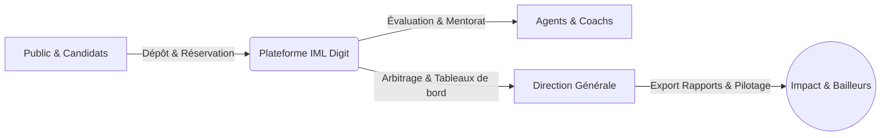

# 🎓 Support Officiel de Présentation de Soutenance
## Plateforme Web Intégrée de Gestion & d'Incubation — IML Digit (Mugheli Lab)

---

## 📌 Fiche Signalétique du Projet
* **Nom du Projet :** IML Digit — Système Intégré de Pilotage et d'Incubation Entrepreneuriale
* **Organisation bénéficiaire :** Incubateur Mugheli Lab (Libreville, Gabon — Quartier Awendjé)
* **Objectif :** Numériser, automatiser et piloter l'intégralité du cycle de vie entrepreneurial (candidatures, parcours d'incubation, accompagnement par coachs, réservation d'infrastructures et arbitrage par la Direction).
* **Architecture :** Full-Stack Moderne TypeScript (React 18 / Vite / TailwindCSS / Express / Prisma ORM / PostgreSQL).

---

## ⏱️ Structure Recommandée pour la Soutenance (15 à 20 Minutes)

| Étape | Durée | Objectif |
| :--- | :---: | :--- |
| **1. Introduction & Contexte** | 3 min | Poser le problème, le contexte gabonais et les enjeux de l'Incubateur Mugheli Lab. |
| **2. Objectifs & Cahier des Charges** | 2 min | Présenter la réponse technologique et les rôles utilisateurs. |
| **3. Architecture & Choix Techniques** | 3 min | Justifier la robustesse du stack (sécurité, scalabilité, temps réel). |
| **4. Démonstration en Direct (Live Demo)** | 7 min | Montrer le tunnel candidat, le cockpit Direction, les alertes et la réservation de salle. |
| **5. Bilan, Sécurité & Perspectives** | 3 min | Évolution future, audit log, retombées d'impact. |
| **6. Questions / Réponses avec le Jury** | 5 à 10 min | Défense technique et ergonomique. |

---

## 🖥️ Plan des Diapositives & Discours Associé (Slide by Slide)

### Diapositive 1 : Titre & Accroche
* **Titre :** Conception et Développement d'une Plateforme Intégrée de Pilotage et d'Accompagnement d'Entrepreneurs : Cas d'IML Digit.
* **Sous-titre :** Du dépôt de candidature à la gouvernance stratégique de l'Incubateur Mugheli Lab.
* **Discours à prononcer :**
  > *« Monsieur le Président du jury, honorables membres du jury, bonjour. J'ai l'honneur de vous présenter aujourd'hui le projet IML Digit. En Afrique centrale, et particulièrement au Gabon, le dynamisme entrepreneurial est freiné par l'absence d'outils digitaux unifiés pour suivre les porteurs de projet. L'Incubateur Mugheli Lab gère des centaines de candidatures, des dizaines d'heures de coaching et des événements dans ses locaux. Ce projet apporte une réponse logicielle sur mesure, fluide et rigoureusement sécurisée. »*

---

### Diapositive 2 : La Problématique Opérationnelle
* **Les 4 freins identifiés avant la solution :**
  1. **Dispersion des données :** Candidatures reçues par formulaires éparpillés, emails ou papier sans suivi centralisé.
  2. **Rupture de suivi des bénéficiaires :** Difficulté à mesurer la progression réelle d'un entrepreneur entre son intégration et sa maturation.
  3. **Manque de réactivité sur les ressources physiques :** Gestion manuelle de la salle de formation entraînant des conflits de créneaux.
  4. **Angle mort pour la Direction :** Absence de métriques consolidées en temps réel pour justifier l'impact auprès des partenaires et bailleurs de fonds.

---

### Diapositive 3 : Les Objectifs & Acteurs de la Plateforme
* **La solution IML Digit orchestre 4 profils avec des droits stricts (RBAC) :**
  * 🌐 **Le Candidat / Public :** Dépose son dossier en ligne avec auto-sauvegarde, ou réserve un créneau de formation sans friction.
  * 👔 **L'Agent / Gestionnaire :** Évalue les dossiers, attribue les jalons, planifie les séances de mentorat.
  * 🎯 **Le Coach / Expert :** Consulte son calendrier d'entretiens et rédige ses comptes-rendus d'évaluation.
  * 🏛️ **La Direction Générale :** Cockpit stratégique décisionnel, arbitrage immédiat des réservations de salle, exports officiels (Excel & PDF exécutif).

---

### Diapositive 4 : Architecture Technique & Sécurité
* **Backend :** Node.js, Express, TypeScript, architecture modulaire en couches (`routes`, `service`, `schemas`).
* **Base de données :** PostgreSQL avec **Prisma ORM**, garantissant une cohérence relationnelle stricte et des migrations versionnées.
* **Frontend :** React 18, TypeScript, TailwindCSS pour un design moderne, réactif et personnalisé aux couleurs de Mugheli Lab (`#FF5B37` orange et `#23C3B1` turquoise).
* **Sécurité & Traçabilité :**
  * Authentification stateless via tokens sécurisés JWT et cookies HttpOnly.
  * Hachage des mots de passe avec **Argon2id** (standard de référence cryptographique).
  * Système complet de **Journal d'Audit (`AuditLog`)** traçant chaque action sensible (création, validation, reprogrammation).
  * Rate-limiting anti-spam sur les endpoints publics.

---

### Diapositive 5 : Les Fonctionnalités Majeures
1. **Tunnel de Candidature Progressif :** Sauvegarde automatique en brouillon, calcul instantané du score de maturité du projet.
2. **Gestion de Salle & Masterclasses :**
   * Choix ergonomique des créneaux (inspiration Calendly, demi-journée, journée, session courte).
   * **Zéro friction tarifaire publique :** Demande directe instruite et qualifiée.
   * **Signalement instantané :** Cloche d'alerte en temps réel sur l'interface + email officiel transmis immédiatement à la Direction.
3. **Cockpit Décisionnel de la Direction :**
   * Visualisation du pipeline de sélection et répartition sectorielle.
   * Suivi dédié des réservations de salle avec validation/refus en un clic.
   * Export instantané en tableur **Excel (.xlsx)** et génération dynamique de rapports **PDF Officiels**.
4. **Assistant Virtuel IA Intégré :** Orienté sur les règles de Mugheli Lab pour assister les visiteurs 24h/24.

---

## 🎬 Scénario de Démonstration en Direct (7 Minutes Chrono)

Ce scénario est spécialement conçu pour captiver le jury en montrant la réactivité de bout en bout :

### Étape 1 : Le Portail Public & la Réservation Simplifiée (2 min)
* Ouvrez [http://localhost:5173/](http://localhost:5173/).
* Montrez l'identité visuelle soignée, le bouton **« Réserver la salle »** et l'accès direct aux candidatures.
* Rendez-vous sur `/salle` :
  * Montrez l'absence de grille tarifaire rigide (expérience utilisateur fluide).
  * Sélectionnez un créneau (ex: *Demi-Journée*), choisissez un jour dans le calendrier interactif et validez les informations d'un organisateur fictif.
  * Validez : mettez en valeur la référence de dossier générée instantanément.

### Étape 2 : L'Alerte et la Réactivité Direction (2 min)
* Ouvrez l'espace connecté Direction [http://localhost:5173/dashboard](http://localhost:5173/dashboard).
* **Attirez l'attention du jury sur la cloche de notification :**
  * La cloche clignote avec une pastille chiffrée.
  * En cliquant dessus, la réservation effectuée à l'étape 1 apparaît en tête de liste avec les coordonnées de l'organisateur.
* Expliquez au jury qu'un **e-mail d'alerte automatique** a également été expédié en arrière-plan à `direction@imldigit.ga`.

### Étape 3 : Le Suivi Stratégique Direction & Décision (2 min)
* Faites défiler jusqu'à la section **« Suivi des Réservations de Salle & Masterclasses »** du tableau de bord Direction.
* Montrez le tableau interactif, les filtres (*En attente*, *Confirmées*) et le bouton **Export Excel**.
* Cliquez sur **« Détails »** : montrez la fiche complète avec les informations de contact.
* Cliquez sur **« Valider & Bloquer »** : montrez que le statut passe au vert et que la salle est définitivement réservée.
* Cliquez sur **« Export Excel »** : montrez le téléchargement immédiat du fichier `.xlsx`.

### Étape 4 : L'Incubation & la Candidature (1 min)
* Montrez brièvement la vue des candidatures et bénéficiaires avec la barre de progression des parcours d'accompagnement.

---

## 💡 Réponses Prêtes aux Questions Classiques du Jury

#### Question 1 : *« Pourquoi avoir supprimé la grille tarifaire fixe sur la page de réservation ? »*
> **Réponse type :**
> *« Mugheli Lab accueille des typologies d'événements très variées : des masterclasses gratuites pour les jeunes, des ateliers associatifs, ou des séminaires d'entreprises privées. Afficher un prix unique créait un frein psychologique pour les porteurs de projets émergents. Nous avons donc opté pour un modèle où la Direction reçoit la demande qualifiée, l'arbitre avec souplesse et établit la convention appropriée sous 24 heures, tout en gardant une traçabilité numérique rigoureuse. »*

#### Question 2 : *« Comment garantissez-vous que deux personnes ne réservent pas le même créneau ? »*
> **Réponse type :**
> *« La plateforme intègre une double protection : d'abord côté front-end avec la fonction `overlapsBusy()` qui désactive les créneaux déjà occupés sur le calendrier interactif, et surtout côté back-end avec une vérification d'indisponibilité au moment du commit en base de données PostgreSQL, empêchant toute concurrence ou double réservation. »*

#### Question 3 : *« Quelle est la robustesse de votre système de notification ? »*
> **Réponse type :**
> *« Le système utilise un canal hybride : une notification persistante in-app synchronisée par React Query qui alerte immédiatement les agents et directeurs connectés, combinée à l'envoi asynchrone d'un e-mail de synthèse via le service de messagerie (`nodemailer`). Ainsi, même si la direction n'est pas devant l'écran, elle est avertie sur son smartphone. »*

#### Question 4 : *« Pourquoi avoir choisi PostgreSQL et Prisma plutôt qu'une base NoSQL comme MongoDB ? »*
> **Réponse type :**
> *« Les données d'un incubateur sont hautement relationnelles : un bénéficiaire possède un ou plusieurs projets, rattachés à des étapes de parcours, jalonnés par des comptes-rendus de coachs et audités par des logs administratifs. PostgreSQL nous offre l'intégrité référentielle ACID, et Prisma nous apporte la sécurité du typage statique de bout en bout en TypeScript, éliminant les erreurs d'exécution. »*

---

## 🎯 Conclusion pour Clôturer la Soutenance
> *« En conclusion, IML Digit n'est pas un simple site vitrine, c'est un véritable progiciel de gestion intégrée au service du développement entrepreneurial. Il résout le triple défi de la transparence, de la réactivité et de la gouvernance pour l'Incubateur Mugheli Lab. Je vous remercie pour votre attention et me tiens à votre entière disposition pour répondre à vos questions. »*
